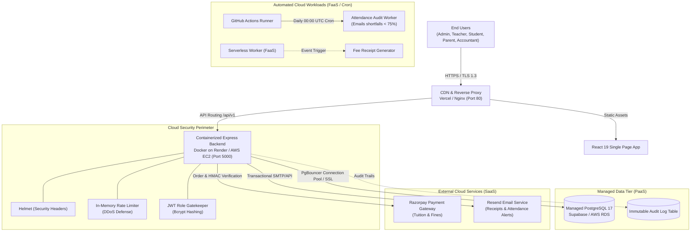

# 🎓 Cloud-Based Student Management System (CSMS)
### Cloud Computing Mini Project (CCMP) — Academic Year 2025–2026

[](https://github.com/Devendra-006/ccmp/actions/workflows/ci.yml)
[](https://www.docker.com/)
[](https://nodejs.org/)
[](https://react.dev/)
[](https://www.postgresql.org/)
[](LICENSE)

---

## 📌 Executive Summary
The **Cloud-Based Student Management System (CSMS / CCMP)** is a production-engineered, cloud-native enterprise web application designed to streamline academic, administrative, and financial operations across universities and colleges. 

Unlike traditional monoliths, this platform is architected around **stateless containerized microservices**, **managed relational cloud databases (PaaS)**, **serverless background workers (FaaS)**, and **third-party fintech & communication APIs (SaaS)** with automated **CI/CD pipelines**.

---

## 🏗️ Cloud System Architecture



---

## ☁️ Cloud Computing Concepts Mapping

This project explicitly demonstrates core Cloud Computing paradigms:

| Cloud Paradigm | Project Component | Technical Implementation |
|---|---|---|
| **IaaS (Infrastructure as a Service)** | Multi-container Deployment | `Dockerfile` & `docker-compose.yml` isolating API, Database, and Web servers with custom network bridging. |
| **PaaS (Platform as a Service)** | Relational Persistence | Managed PostgreSQL 17 on Supabase with automated replication, connection pooling, and automated backups. |
| **SaaS (Software as a Service)** | Payments & Communications | Razorpay API for online checkout and Resend for transactional email delivery. |
| **FaaS (Function as a Service)** | Event-Driven Worker | `serverless/receipt-generator/handler.js` for on-demand PDF receipts without idle server consumption. |
| **Cloud Observability** | Container Health Probes | `/api/v1/health` reporting live database ping, RSS/Heap memory metrics, and process uptime for Kubernetes/Docker probes. |
| **Automation & CI/CD** | Continuous Delivery | `.github/workflows/ci.yml` running linting, database migrations, end-to-end tests, and dual Docker builds on every push. |

---

## 👥 Multi-Role Access Control (RBAC)

The system enforces strict Role-Based Access Control both at the frontend routing layer and on all backend endpoints:

1. **🏛️ Super / Academic Administrator:**
   - Academic master creation: Departments, Programmes (Degrees), Subjects, and Classes.
   - Student admissions & faculty onboarding with automated email credentials dispatch.
   - Fee structure definitions and campus-wide notice broadcasts.
   - Immutable security and financial audit trail review.

2. **👨‍🏫 Faculty / Teacher:**
   - Real-time session attendance marking with SQL `UPSERT` (prevents double-entry errors).
   - Examination grade entry and automatic letter grade & grade point calculation.
   - Assigned class roster and student directory view.

3. **👨‍🎓 Student:**
   - Real-time overall and subject-wise attendance tracking with visual threshold alerts (< 75%).
   - Timetable view and exam marksheets with calculated SGPA.
   - Online fee dues payment via Razorpay with instant branded PDF receipt generation.

4. **👪 Parent:**
   - Ward academic progress monitoring and low attendance alerts.
   - Remote online settlement of pending semester dues.

5. **💼 Accountant:**
   - Tuition fee collections ledger and payment reconciliation records.

---

## 🚀 Quick Start & Local Setup

### Option A: Running with Docker Compose (Recommended)
Make sure you have [Docker Desktop](https://www.docker.com/) installed:

```bash
# 1. Clone repository
git clone https://github.com/Devendra-006/ccmp.git
cd ccmp

# 2. Configure environment file
cp .env.example .env

# 3. Spin up all containers (Database + API + Frontend)
docker compose up --build
```
* Frontend will be live at: `http://localhost:80`
* Backend API will be live at: `http://localhost:5000`

---

### Option B: Running Bare-Metal with Node.js
Requirements: Node.js 20+ and npm.

```bash
# 1. Install dependencies
npm install

# 2. Set up environment variables
# Copy .env.example to .env and input your PostgreSQL DATABASE_URL
cp .env.example .env

# 3. Initialize Database Schema & Seed Admin
npm run db:migrate
node server/db/initDb.js

# 4. Start backend server (Terminal 1)
npm run server

# 5. Start frontend dev server (Terminal 2)
npm run dev
```
* Frontend: `http://localhost:5173/`
* Backend: `http://localhost:5000/`

---

## 🔑 Demo Login Credentials (Out of the Box)

Click the **"Sign In"** button on the top navbar or use these default accounts:

| Role | Email | Password | Access Scope |
|---|---|---|---|
| **Administrator** | `admin@campus.edu` | `Admin@123` | Full Institution Control |
| **Faculty Member** | `teacher@campus.edu` | `Teacher@123` | Grading & Attendance |
| **Student** | `student@campus.edu` | `Student@123` | Academics & Fees |

*(Tip: In the Sign-In modal, click **"⚡ Quick Fill Seeded Admin"** to test immediately).*

---

## 📊 Cloud Container Health & Observability

The application exposes a structured health probe for cloud monitoring services (AWS Route53, Render, Kubernetes):

```bash
GET /api/v1/health
```

**Sample Response:**
```json
{
  "status": "healthy",
  "timestamp": "2026-10-17T23:40:00.000Z",
  "service": "Cloud Student Management System API",
  "version": "1.0.0",
  "environment": "production",
  "uptimeSeconds": 1420,
  "database": "connected",
  "memory": {
    "rssMB": 52,
    "heapUsedMB": 28
  }
}
```

---

## 🧪 Verification & Testing Suite

Run all cloud integration and unit tests:

```bash
# Test all external cloud integrations (PostgreSQL, Supabase Auth, Razorpay, Resend)
npm run test:services

# Run backend end-to-end database lifecycle test
npm run test:e2e

# Run scheduled attendance shortfall audit job manually
npm run cron:attendance

# Run code linter
npm run lint

# Build production frontend bundle
npm run build
```

---

## 🎓 Examiner Viva Q&A Guide

Prepare these concise answers for your project evaluation:

1. **Q: Why this cloud architecture over a traditional local server?**
   * *Answer:* Scalability and resilience. The frontend is delivered globally via CDN edges. The API layer is stateless and horizontally scalable inside Docker containers. The database tier uses cloud PostgreSQL with automated replication and connection pooling.

2. **Q: How does the system handle high traffic during exam results release?**
   * *Answer:* The API is stateless with connection pooling via PgBouncer. High-traffic endpoints utilize database indexes on `student_id` and `exam_id`. Sensitive routes are protected by `express-rate-limit` to prevent denial-of-service.

3. **Q: How are credentials and sensitive data secured in the cloud?**
   * *Answer:* Never committed to source control; managed via runtime environment variables. Passwords are encrypted with salt using `bcryptjs`. APIs enforce JWT bearer authorization with role checks. HTTP headers are protected via `helmet`.

4. **Q: What happens if the API server crashes?**
   * *Answer:* Docker container restart policies (`restart: always`) automatically revive the process in seconds. Database state remains intact because persistence is isolated in a separate managed cloud database.

5. **Q: Where is serverless compute demonstrated in this project?**
   * *Answer:* In `serverless/receipt-generator/handler.js`, which encapsulates an AWS Lambda event handler for fee receipt rendering, and in `.github/workflows/cron.yml` which executes scheduled attendance audits serverlessly.

---

## 📄 License
This project is licensed under the [MIT License](LICENSE).
