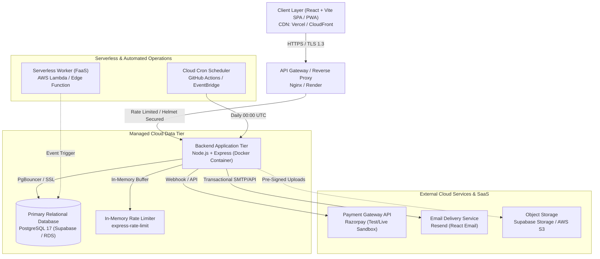

# Cloud System Architecture & Technical Specifications
**Project:** Cloud-Based Student Management System (CSMS / CCMP)  
**Target:** Academic & Cloud Computing Evaluation

---

## 1. Cloud Architecture Diagram

---

## 2. Cloud Computing Service Model Mapping (IaaS vs PaaS vs SaaS vs FaaS)

| Cloud Model | Component in this Project | Provider / Technology | Architectural Rationale |
|---|---|---|---|
| **IaaS (Infrastructure as a Service)** | Compute Containers | Docker, AWS EC2 / Render Container runtime | Full control over Node.js execution runtime, ports, and OS dependencies with isolated Linux user. |
| **PaaS (Platform as a Service)** | Database Persistence Tier | Supabase PostgreSQL 17 / Neon | Managed database with automatic backups, high availability, connection pooling, and SSL termination. |
| **SaaS (Software as a Service)** | Payment Processing & Email | Razorpay (Fintech SaaS), Resend (Communication SaaS) | Offloads PCI-DSS compliance and email deliverability without running mail or card processing servers. |
| **FaaS (Function as a Service / Serverless)** | Receipt & Document Generator | AWS Lambda / Serverless Worker | Zero idle compute cost; autoscales on demand during semester fee deadlines. |

---

## 3. High Availability & Scalability Strategy

1. **Stateless API Tier:**
   The Express server maintains no in-memory session states. Sessions are verified via signed JSON Web Tokens (JWT). This allows running multiple container instances behind a round-robin load balancer without session stickiness issues.
2. **Connection Pooling:**
   Direct queries use PostgreSQL connection pooling with maximum pool ceilings and keep-alive recycling to prevent connection exhaustion during concurrent student traffic.
3. **Database Indexing:**
   High-cardinality search columns (`enrolment_no`, `roll_no`, `student_id`, `subject_id`, `date`) have B-Tree indexes configured in PostgreSQL.

---

## 4. Multi-Role Access Control Matrix (RBAC)

| Role | Admin Portal | Faculty Portal | Student Dashboard | Fee Payment | Gradebook |
|---|:---:|:---:|:---:|:---:|:---:|
| **Super / Academic Admin** | Full (CRUD) | View | View | Manage Dues | Audit |
| **Teacher / Faculty** | No Access | Full (Mark/Grade) | View Class | No Access | Read / Write |
| **Student** | No Access | No Access | Self Data Only | Pay & Receipts | View Only |
| **Parent** | No Access | No Access | Ward Data Only | Pay Ward Fees | View Only |
| **Accountant** | Financials | No Access | No Access | Full Reconciliation | No Access |
